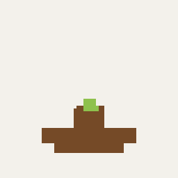
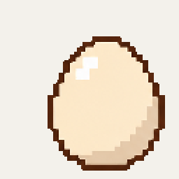
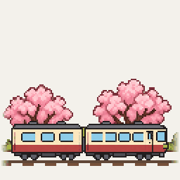
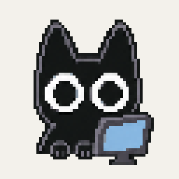

# Countdown

English | [简体中文](README.md)

A pixel countdown for your macOS desktop, with customizable themes.

## Themes

All themes below are built in.

| Theme | Bloom | Hatching Chick | Seasonal Train | Black Cat |
| --- | --- | --- | --- | --- |
| Preview |  |  |  |  |

## Usage

- Requires macOS 14 or later.
- Click the artwork to start, pause, or resume. Hover to reveal controls.
- Drag to move the widget. Right-click to open Settings and adjust the duration, widget size, and remaining-time display.

## Custom Themes

Click “+” in Settings → Themes, or drag a theme ZIP onto the page.

Themes consist of a PNG sprite sheet and JSON configuration. Use the [theme creation prompt](docs/THEME_PROMPT.md) (Chinese) to create your own artwork.
