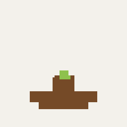
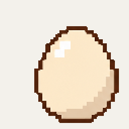

# Countdown

[English](README.en.md) | 简体中文

一个支持自定义主题的 macOS 桌面像素倒计时。

## 主题

以下主题均已内置。

| 主题 | 开花 | 小鸡孵化 | 四季列车 | 黑猫 |
| --- | --- | --- | --- | --- |
| 预览 |  |  |  |  |

## 使用

- 支持 macOS 14 及以上版本。
- 单击素材开始、暂停或继续计时，悬浮显示控制按钮。
- 拖动移动组件，右键打开设置，调整时长、大小和剩余时间显示。

## 自定义主题

在“设置 → 主题”点击“＋”，或直接拖入主题 ZIP。

主题由 PNG 精灵图和 JSON 配置组成，也可以使用 [主题制作提示词](docs/THEME_PROMPT.md) 制作自己的素材。
